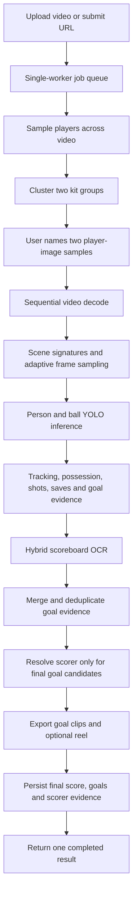
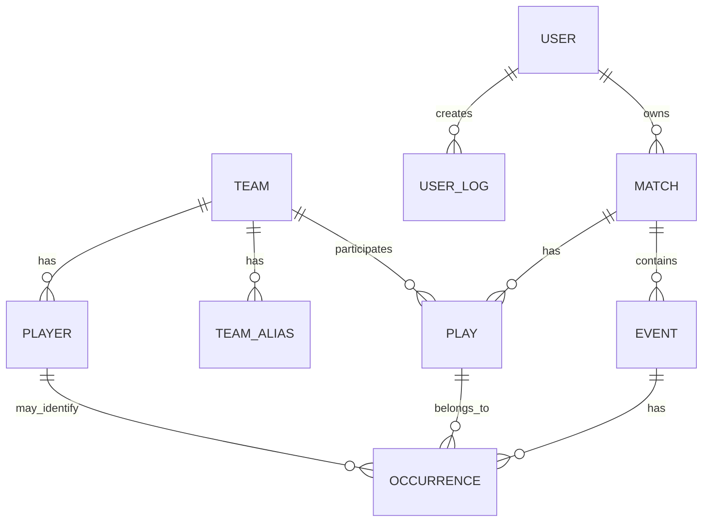

# Footy AI Pipeline Guide and Code Map

This document is the practical table of contents for the current Footy AI codebase. It explains the user journey, the video-analysis pipeline, API endpoints, storage locations, database records, and the responsibility of each important source file.

> **Current implementation:** the web application uses the goal-focused `PipelineConfig.short_clip()` profile. The command-line entry point can still run the broader/full profile. The historical `main(v1).py`, `main(v2).py`, `event_detector(v1).py`, `event_detector(v2).py`, `event_logic(V1).py` and the unused camera-movement, speed/distance and view-transformer packages were deleted on 2026-10-14 (recoverable from git history).

## Contents

1. [Quick mental model](#1-quick-mental-model)
2. [User journey](#2-user-journey)
3. [End-to-end processing pipeline](#3-end-to-end-processing-pipeline)
4. [Web API reference](#4-web-api-reference)
5. [Job states and progress](#5-job-states-and-progress)
6. [Input, output, and generated-file storage](#6-input-output-and-generated-file-storage)
7. [Source-code map](#7-source-code-map)
8. [Function and class index](#8-function-and-class-index)
9. [Models and roster data](#9-models-and-roster-data)
10. [Database structure](#10-database-structure)
11. [Result payloads](#11-result-payloads)
12. [Configuration and environment variables](#12-configuration-and-environment-variables)
13. [Running the application](#13-running-the-application)
14. [Tests and acceptance coverage](#14-tests-and-acceptance-coverage)
15. [Failure handling and fallbacks](#15-failure-handling-and-fallbacks)
16. [Deferred and legacy components](#16-deferred-and-legacy-components)
17. [Where to make common changes](#17-where-to-make-common-changes)

## 1. Quick mental model



The main orchestration path is:

```text
backend/static/app.js
  -> backend/routers/processing.py
  -> backend/pipeline_runtime.py
  -> main.py::process_video()
  -> trackers + scene + track_events + scoreboard + scorer_identifier
  -> highlights
  -> backend/routers/processing.py::_persist_match()
  -> SQL Server + JSON API result
```

The web profile is deliberately focused on final score, goals, scorer evidence, and goal highlights. Passes, crosses, fouls, cards, penalties, pitch calibration, and the legacy LSTM event model remain in the repository but are not run for web jobs.

## 2. User journey

1. The browser loads `backend/static/index.html` from `GET /`.
2. The user uploads a video or supplies a direct video URL.
3. The backend saves a temporary UUID-named source video in `backend/uploads/`.
4. The job enters the one-worker queue and samples representative players across the video.
5. The backend clusters the samples into two kit groups and writes one representative image for each group to `backend/static/team_samples/`.
6. The browser shows those player images. The user names the two visual teams. The UI never asks the user to interpret a hex color.
7. The same confirmed cluster centers are reused during match analysis; the web path does not calibrate the teams a second time.
8. The backend analyses the video, resolves the final score and goal scorers, cuts goal highlights, and saves database records.
9. The browser continues polling while the job runs, but shows the result only after scoring, scorer resolution, highlights, and persistence have all completed.
10. The uploaded source is deleted after success or failure. Generated highlights and evidence remain available.

The product and design intent are described in [PRODUCT.md](PRODUCT.md) and [DESIGN.md](DESIGN.md). The responsive implementation is in [backend/static/index.html](backend/static/index.html), [backend/static/app.js](backend/static/app.js), and [backend/static/app.css](backend/static/app.css).

## 3. End-to-end processing pipeline

### 3.1 Submission and queuing

- `submit_file()` accepts MP4, MOV, AVI, or MKV files, with a 2 GB maximum.
- `submit_url()` downloads a direct video URL into the same upload directory.
- `_create_job()` creates the in-memory job record.
- `SerialJobQueue` has exactly one worker. A second upload stays queued instead of loading another copy of the models or competing for CPU and memory.
- Job records are held in the `_jobs` dictionary in `backend/routers/processing.py`. They do not survive a backend restart; completed match records in SQL Server do.

### 3.2 One-time team sampling and confirmation

`_detect_team_candidates()` performs the pre-confirmation team pass:

1. It samples 24 to 60 positions distributed across the complete video.
2. The shared person detector finds outfield players.
3. `safe_player_crop()` rejects unusably small player crops.
4. `kit_color_bgr()` extracts a robust shirt/kit color.
5. `cluster_team_samples()` forms two sufficiently large and separated kit clusters.
6. `render_team_sample()` creates readable player evidence images.
7. The API exposes only the two representative images and neutral labels.
8. When the user confirms the names, the cluster centers become the internal team colors supplied to `MatchConfig`.

The colors are implementation data, not a user-facing identity mechanism.

### 3.3 Short-clip configuration

`PipelineConfig.short_clip()` selects the optimized web behavior:

| Setting | Web behavior |
| --- | --- |
| Analysis frame rate | 12 FPS for clips up to 60 seconds; 10 FPS for longer clips |
| Original timing | Original source frame numbers and timestamps are retained |
| Detector size | 640 px for sources through 720p; 960 px above 720p |
| Event output | Goals only |
| Internal evidence | Possession, shots, saves, and goals |
| Disabled work | Passes, crosses, penalties, fouls, cards, pitch calibration, legacy LSTM |
| Scoreboard cadence | Base scan every 2 seconds |
| Scoreboard burst | Every 0.5 seconds for 8 seconds after a shot |
| Identity crops | Four best crops initially |
| OCR debug images | Off unless explicitly enabled |

`scheduled_frames()` determines which source frames go through detection without accumulating timestamp drift.

### 3.4 Shared models and per-job state

`backend/pipeline_runtime.py` owns the process-wide resource cache:

- `ModelCache.yolo()` loads each YOLO weights file once and returns the same model object to later jobs.
- `ModelCache.paddle_ocr()` initializes PaddleOCR once and shares its engine.
- Each analysis still creates a fresh `Tracker`, ByteTrack state, event detector state, possession history, and scoreboard state. Tracking identities therefore never leak between jobs.

### 3.5 Sequential decode and scene handling

`main.py::process_video()` opens the source once for the main analysis pass.

- Every decoded frame keeps its original frame index.
- `frame_signature()` is calculated during that same sequential decode.
- A rolling signature window is passed to `find_boundaries()` to find hard cuts and dissolves.
- `SceneTimeline` marks transitions and new scenes.
- Tracking and possession state reset at scene boundaries, preventing replay footage from inheriting live-play identities.
- Only scheduled frames enter the expensive YOLO batches; batch size is 16.

The standalone `scene.detect_scene_boundaries()` helper still exists for tests and full/offline uses, but the active web pipeline does not perform a separate full-video scene pass.

### 3.6 Person, referee, and ball detection

`trackers/tracker.py` performs detection and tracking:

- `models/best.pt` detects people, goalkeepers, referees, and its fallback ball class.
- `models/ball_detector_best.pt` is the preferred dedicated ball detector when present.
- `Tracker.get_object_tracks()` batches detections and feeds per-job ByteTrack instances.
- `BallSelector` chooses a plausible ball when several detections exist.
- The tracker records person and ball inference time and frame counts for pipeline metrics.

### 3.7 Team assignment and possession

- `TeamAssigner` compares each player kit feature with the two confirmed cluster centers.
- `PlayerBallAssigner` determines the player nearest enough to possess the ball.
- Only the current possessor is sent to `ScorerIdentifier.observe_players()` for quality crop collection. This avoids storing and OCR-processing every visible player.
- `PossessionHistory` keeps recent possession evidence for later goal attribution.

### 3.8 Event evidence

`TrackEventDetector` receives the tracked players, ball, referees, and optional pitch calibration for each analysed frame.

In the web profile it retains the reasoning needed for:

- possession changes;
- shots and their shooter;
- saves and their goalkeeper;
- track-derived or goal-mouth-derived goal proposals.

It does not produce web-profile passes, crosses, penalties, fouls, or cards. Those implementations remain available to the full profile.

### 3.9 Hybrid scoreboard OCR

`scoreboard/reader.py` is the broadcast-score reader:

1. It scans likely top and bottom screen bands rather than OCR-reading every full frame.
2. Once a scoreboard is found, it locks to a tight region.
3. Normal scans run every two seconds.
4. A detected shot calls `trigger_burst()`, temporarily reading every 0.5 seconds.
5. `scoreboard/parser.py` converts PaddleOCR tokens into team codes and score values.
6. `ScoreTracker` requires repeated agreement before confirming state changes.
7. Expected team-code filtering is loosened after repeated misses so unfamiliar broadcasts can recover.
8. Rejected tokens, scan regions, and confidence summaries are logged. Images are saved only when diagnostics are enabled.

Team-code knowledge comes from, in order:

1. `teams.short_code` and three-letter aliases in SQL Server;
2. the team files in `data/rosters/`;
3. spelling similarity between the displayed code and the confirmed team name.

### 3.10 Goal merging, attribution, and final score

After the frame loop:

- `merge_board_goals()` combines confirmed scoreboard changes with track/pitch goal proposals.
- `attribute_goals()` uses evidence within the score-change window to choose the event time and team.
- `drop_replayed_goals()` removes repeated detections caused by replay sequences.
- `withdraw_saves_of_goals()` removes a save that is actually part of the same confirmed goal.
- Duplicate scoreboard and track goals are collapsed before scoring and highlights.
- If the scoreboard has a confirmed latest state, `final_score_by_team()` treats it as authoritative.
- If scoreboard OCR never becomes reliable, the final score falls back to deduplicated goal events.
- If the scoreboard confirms a goal that tracking missed, a scoreboard-sourced goal is created without inventing a scorer.

### 3.11 Scorer resolution

Scorer work runs only for final goal candidates:

1. Live possession and shooter evidence propose a track.
2. `JerseyReader` evaluates the best four torso crops first.
3. Extra variants are tried only when the evidence is inconclusive and the OCR budget allows it.
4. A jersey number is accepted only when repeated evidence reaches the required consensus.
5. The roster maps `(team, jersey number)` to a player name.
6. Celebration crops and broadcast caption OCR are fallback evidence.
7. `fuse_scorer()` combines live, jersey, celebration, roster, and caption evidence.
8. Weak evidence remains explicitly unconfirmed. The pipeline returns an unknown number/name instead of guessing.

Debug crop dumping is disabled in the web profile. The CLI can enable it through its OCR debug directory.

### 3.12 Goal highlights

`highlights/` plans and writes only goal clips for the goal-focused profile:

- `event_window()` chooses a useful lead-in and aftermath around a goal while respecting scene boundaries.
- `plan_clips()` merges overlapping goal windows.
- `cut_clip()` prefers FFmpeg to retain source audio and compatible MP4 output.
- `_cut_with_opencv()` is the fallback if FFmpeg is unavailable.
- `concat_clips()` creates `reel.mp4` for multiple goals using stream-copy concatenation when possible.
- Clip URLs are copied onto their corresponding event objects.

### 3.13 Persistence and completion

`backend/routers/processing.py::_persist_match()` writes:

- the match and its owner;
- the two teams and final scores;
- final goal events only in the web profile;
- scorer/actor occurrence evidence;
- roster-linked player identity where evidence permits it;
- highlight URL/path and clip bounds.

Shots and saves can contribute to attribution but are not persisted as final web-profile events. Once persistence completes, the job becomes `completed`, the result becomes available, and the temporary uploaded source is deleted.

## 4. Web API reference

The FastAPI application is created in `backend/app.py`. Swagger/OpenAPI documentation is available at `/docs` while the server is running.

### General endpoints

| Method | Route | Function | Purpose |
| --- | --- | --- | --- |
| `GET` | `/` | `backend.app.root` | Serve the browser application |
| `GET` | `/health` | `backend.app.health` | Lightweight service health response |
| `GET` | `/docs` | FastAPI built-in | Interactive OpenAPI documentation |
| `GET` | `/static/...` | mounted `StaticFiles` | Serve CSS, JS, team samples, player images, and static outputs |

### User endpoints

| Method | Route | Function | Request/response |
| --- | --- | --- | --- |
| `POST` | `/api/users/register` | `backend.routers.users.register` | Accepts username, email, password; creates a bcrypt password hash and registration log |
| `POST` | `/api/users/login` | `backend.routers.users.login` | Validates email/password and records a login log |
| `GET` | `/api/users/{user_id}` | `backend.routers.users.get_user` | Returns `userId`, `username`, and `email` |

### Processing endpoints

| Method | Route | Function | Purpose |
| --- | --- | --- | --- |
| `POST` | `/api/processing/submit-file` | `submit_file` | Multipart upload using field `video`; optional form field `user_id`; returns `202` and a job ID |
| `POST` | `/api/processing/submit-url` | `submit_url` | Downloads JSON `video_url`; optional `user_id`; returns `202` and a job ID |
| `POST` | `/api/processing/confirm-teams/{job_id}` | `confirm_teams` | Accepts `team_1_name` and `team_2_name`, then queues full analysis |
| `GET` | `/api/processing/status/{job_id}` | `job_status` | Returns current status, stage, percent, candidate images, and error |
| `GET` | `/api/processing/result/{job_id}` | `job_result` | Returns the completed result; returns `409` before completion |
| `GET` | `/api/processing/clips/{job_id}/{file_name}` | `job_clip` | Serves an MP4 clip/reel with byte-range support for video players |

Example confirmation body:

```json
{
  "team_1_name": "Portugal",
  "team_2_name": "Egypt"
}
```

### Stored-match endpoints

| Method | Route | Function | Purpose |
| --- | --- | --- | --- |
| `GET` | `/api/matches?user_id={id}` | `get_matches` | Lists all matches, or only one user's matches |
| `GET` | `/api/matches/{match_id}` | `get_match_summary` | Returns match, teams, scores, goals, occurrences, players, and reel URL |

## 5. Job states and progress

| Status | Meaning | Typical stage text |
| --- | --- | --- |
| `uploaded` | Internal initial state before queue submission | `Video uploaded` |
| `queued` | Waiting for the only CV worker | `Queued for team detection` or `Team names confirmed` |
| `detecting_teams` | Sampling player crops and kit clusters | `Finding representative players` |
| `awaiting_team_confirmation` | Candidate player images are ready | `Name the detected teams` |
| `processing` | Main video analysis is running | `Analysing frame X of Y` |
| `completed` | Results, clips, and database rows are ready | `Analysis complete` |
| `failed` | Team detection or processing raised an error | `Team detection failed` or `Processing failed` |

`GET /api/processing/status/{job_id}` returns:

```json
{
  "job_id": "uuid",
  "status": "processing",
  "stage": "Analysing frame 420 of 650",
  "progress_percent": 63,
  "team_candidates": null,
  "error": null
}
```

## 6. Input, output, and generated-file storage

All paths below are relative to the repository root.

| Data | Directory/file pattern | Created by | Lifetime and access |
| --- | --- | --- | --- |
| Bundled/manual input videos | `input_videos/` | Developer/user | Kept; used by CLI, fixtures, and manual testing |
| Web-uploaded source | `backend/uploads/{uuid}.{ext}` | `submit_file()` | Temporary; deleted when job succeeds/fails, or after stale-upload cleanup |
| URL-downloaded source | `backend/uploads/{uuid}.mp4` | `submit_url()` | Same temporary lifecycle as uploads |
| Team confirmation samples | `backend/static/team_samples/{job_id}-team-{1|2}.jpg` | `_detect_team_candidates()` | Kept indefinitely; public under `/static/team_samples/...` |
| Goal scorer/player images | `backend/static/player_images/{job_id}/...` | `_save_scorer_image()` | Kept indefinitely; public under `/static/player_images/...` |
| Goal clips | `backend/static/clips/{job_id}/*.mp4` | `export_highlights()` | Kept indefinitely; served through the range-enabled clip API |
| Multi-goal reel | `backend/static/clips/{job_id}/reel.mp4` | `concat_clips()` | Kept indefinitely; served through the clip API |
| Optional annotated web output | `backend/static/outputs/{job_id}.mp4` | `process_video()` | Currently not written because the web profile disables full annotated rendering |
| Optional web OCR debug images | `backend/static/ocr_debug/` | OCR components | Disabled by default; kept if diagnostics are explicitly enabled |
| CLI annotated output | `output_videos/output.mp4` by default | `main.py` | Created only with `--write-annotated-video` |
| CLI OCR debug crops | `output_videos/ocr_debug/` by default | `JerseyReader` | Created when CLI OCR diagnostics are enabled |
| CLI player images | `output_videos/player_images/` by default | scorer pipeline | Developer-managed |
| UI reference images | `output_videos/ui-desktop.png`, `output_videos/ui-mobile.png` | UI capture workflow | Committed design references |
| Roster inputs | `data/rosters/*.json` | Maintainers | Source-controlled team aliases, codes, and squads |
| SQL records | SQL Server database `FootballDB` by default | `_persist_match()` | Persistent until database maintenance removes them |

### Upload cleanup rules

`backend/cleanup.py` only deletes UUID-named source files written by the service. It refuses paths outside `backend/uploads/`.

- A completed or failed job deletes its source immediately.
- An abandoned/orphaned source is removed after `FOOTY_UPLOAD_MAX_AGE_HOURS` (24 hours by default).
- Setting the value to `0` keeps uploads forever.
- Goal clips, reels, player images, OCR evidence, and team samples are not automatically deleted.

### Important storage note

The `Match.source_video` database field records the job's original upload path, but that temporary file is removed after processing. Historical playback should use the persisted event clip URLs and reel, not `source_video`.

## 7. Source-code map

### Application and browser UI

| Path | Responsibility |
| --- | --- |
| `backend/app.py` | FastAPI creation, CORS, static mount, routers, startup cleanup, demo-user seed, root and health routes |
| `backend/static/index.html` | Accessible upload, team confirmation, processing, and result screen markup |
| `backend/static/app.js` | Browser state, API calls, polling, validation, team confirmation, and result rendering |
| `backend/static/app.css` | Responsive visual system and page/component styling |
| `PRODUCT.md` | Product behavior and intended end-user flow |
| `DESIGN.md` | Visual-system reference |

### API, jobs, and persistence

| Path | Responsibility |
| --- | --- |
| `backend/routers/processing.py` | Processing APIs, job state, team sampling, pipeline invocation, results, clip serving, and database persistence |
| `backend/routers/users.py` | Registration, login, user lookup, and audit logs |
| `backend/pipeline_runtime.py` | One-worker queue and process-wide YOLO/PaddleOCR cache |
| `backend/schemas.py` | Pydantic request and response models |
| `backend/cleanup.py` | Safe uploaded-source deletion and stale-upload sweep |

### Main video pipeline

| Path | Responsibility |
| --- | --- |
| `main.py` | End-to-end orchestration for CLI and API jobs |
| `pipeline_config.py` | Full/short profile switches, adaptive scheduling, and phase/count metrics |
| `match_config.py` | Validated team names and internal RGB/BGR kit colors |

### Detection and tracking

| Path | Responsibility |
| --- | --- |
| `trackers/tracker.py` | YOLO person/ball inference, ByteTrack integration, ball selection, positions, and annotations |
| `player_ball_assigner/` | Nearest-player ball-possession assignment |
| `team_assigner/calibration.py` | Safe crops, kit color extraction, two-cluster calibration, and representative sample rendering |
| `team_assigner/team_assigner.py` | Match player kit features to confirmed team centers |

### Scene, events, and pitch

| Path | Responsibility |
| --- | --- |
| `scene/cuts.py` | Frame signatures, hard-cut/dissolve detection, and scene timeline |
| `track_events/detector.py` | Rule-based possession, pass, cross, shot, save, penalty, and goal reasoning; profile flags select active work |
| `track_events/goal_mouth.py` | Image-space goal-mouth geometry |
| `track_events/goal_merge.py` | Replay-goal deduplication and goal/save reconciliation |
| `track_events/fouls.py` | Contact/foul rules; disabled in short web profile |
| `track_events/cards.py` | Card-color evidence near referees; disabled in short web profile |
| `pitch/calibration.py` | Optional keypoint-to-pitch homography fitting; disabled in short web profile |
| `pitch/layout.py` | Real-world pitch geometry helpers; used only with accepted pitch calibration |

### Scoreboard and scorer identity

| Path | Responsibility |
| --- | --- |
| `scoreboard/reader.py` | Hybrid scan/lock/burst OCR schedule and confirmed score-state tracking |
| `scoreboard/parser.py` | Convert OCR tokens into team-code and score readings |
| `scoreboard/teams.py` | Expected codes and code-to-confirmed-team mapping |
| `scoreboard/attribution.py` | Merge scoreboard goals and attach time/team/player evidence |
| `scorer_identifier/identity.py` | Best-crop storage, possession history, OCR identity reads, and goal formatting |
| `scorer_identifier/jersey_reader.py` | Crop enhancement, PaddleOCR, number/name candidates, consensus, and budgets |
| `scorer_identifier/goal_scorer.py` | Roster lookup, caption/celebration/live candidates, and evidence fusion |

### Highlights

| Path | Responsibility |
| --- | --- |
| `highlights/segments.py` | Event windows and non-overlapping clip plans |
| `highlights/encoder.py` | FFmpeg/FFprobe discovery, MP4 cutting, concatenation, bitrate, and OpenCV writer |
| `highlights/export.py` | Execute clip plans, fall back to OpenCV, annotate event objects, and build API clip summaries |

### Database and roster

| Path | Responsibility |
| --- | --- |
| `backend/database.py` | SQL Server connection, database creation, SQLAlchemy engine/session, `get_db()` dependency |
| `backend/models.py` | SQLAlchemy tables and relationships |
| `backend/schema.py` | Additive migration checks for team codes and event clip-time fields |
| `backend/team_naming.py` | Normalize manually typed club/team names and aliases |
| `backend/roster.py` | Resolve teams, manage aliases, seed players, and read roster JSON files |
| `scripts/seed_roster.py` | CLI for dry-run, write, and report modes of roster seeding |

## 8. Function and class index

This index covers active entry points and the important reusable internals. Small private geometry/string helpers are kept next to the component that owns them.

### `main.py`

| Symbol | What it does |
| --- | --- |
| `build_parser()` | Declares CLI arguments and defaults |
| `process_video(args, progress_cb=None)` | Runs the complete analysis pipeline and returns events, score, and metrics |
| `should_calibrate_teams()` | Skips duplicate calibration when web-confirmed centers already exist |
| `_calibrate_teams()` | Full/CLI profile team calibration fallback |
| `_assign_teams()` | Adds team identity/confidence to tracked players |
| `_record_ball_possession()` | Adds current possessor evidence to scorer history |
| `_frame_tracks()` | Extracts one frame from batched track dictionaries |
| `_resolve_identities()` | Resolves OCR/roster identity for event actors |
| `_improve_goal_scorers()` | Fuses live, celebration, jersey, roster, and optional caption evidence |
| `final_score_by_team()` | Uses confirmed scoreboard state, otherwise deduplicated goal counts |
| `goal_output_events()` | Filters output to goal events |
| `describe_event()` / `format_goal_event()` | Produce readable event descriptions without fabricating identity |
| `_save_scorer_image()` | Writes the selected scorer evidence image |

### `pipeline_config.py`

| Symbol | What it does |
| --- | --- |
| `PipelineConfig` | Immutable profile settings |
| `PipelineConfig.short_clip()` | Builds the optimized goal-focused web profile |
| `analysis_fps()` | Chooses 12 or 10 FPS from duration |
| `detector_size()` | Chooses 640 or 960 px from source height |
| `scheduled_frames()` | Yields stable original-frame indices at target FPS |
| `PipelineMetrics` | Accumulates phase seconds and call/frame counts |

### `backend/routers/processing.py`

| Symbol | What it does |
| --- | --- |
| `_create_job()`, `_set_job()`, `_job_snapshot()` | Thread-safe in-memory job management |
| `_detect_team_candidates()` | One-time sampling, kit clustering, and representative images |
| `_process_job()` | Builds short-profile arguments, invokes `process_video()`, persists, and assembles API result |
| `_persist_match()` | Writes teams, scores, final events, actors, and evidence to SQL Server |
| `_team_codes()` | Gets scoreboard codes from canonical team and alias rows |
| `_get_or_create_team()` | Resolves typed names to canonical teams |
| `_roster_player()` | Resolves `(team, jersey)` to roster row without trusting OCR for names |
| `sweep_media()` / `_release_job_files()` | Clean temporary uploaded sources |
| `_reel()` | Find a stored job reel and create its API metadata |

### `trackers/tracker.py`

| Symbol | What it does |
| --- | --- |
| `Tracker` | Owns YOLO calls, per-job trackers, batched result conversion, positions, and annotation |
| `detect_outfield_players()` | Lightweight person-only detection used for team samples |
| `detect_balls()` | Runs the dedicated/fallback ball detector |
| `detect_frames()` | Runs person detection in batches |
| `get_object_tracks()` | Produces per-frame player/referee/goalkeeper/ball tracks |
| `BallSelector` | Scores competing ball boxes for temporal plausibility |
| `choose_image_size()` / `choose_ball_image_size()` | Full-profile detector sizing helpers |
| `is_on_pitch()` | Rejects people whose lower box is not over enough grass |

### `team_assigner/`

| Symbol | What it does |
| --- | --- |
| `TeamSample` | Color, crop, source frame, box, and quality bundle |
| `safe_player_crop()` | Clamps and validates crop dimensions |
| `crop_sharpness()` | Scores evidence quality |
| `kit_color_bgr()` | Extracts shirt color while rejecting grass/background |
| `cluster_team_samples()` | Validates and clusters two kits |
| `render_team_sample()` | Produces the confirmation image shown to the user |
| `TeamAssigner` | Stores centers and assigns tracked players to team 1 or 2 |

### `scene/cuts.py`

| Symbol | What it does |
| --- | --- |
| `frame_signature()` | Builds a compact scene signature |
| `find_boundaries()` | Finds hard cuts and dissolves in signature sequences |
| `SceneBoundary` | Start, end, type, and strength of one transition |
| `SceneTimeline` | Answers whether a frame starts a scene or lies in a transition |
| `detect_scene_boundaries()` | Standalone/offline full-file helper, not the web pipeline pass |

### `scoreboard/`

| Symbol | What it does |
| --- | --- |
| `paddle_ocr_fn()` | Adapts a shared PaddleOCR engine to the reader callback |
| `ScoreboardReader` | Finds/locks a score region and schedules base/burst reads |
| `ScoreTracker` | Confirms states and produces valid score changes/withdrawals |
| `ScoreGoal` / `ScoreReading` / `Token` | Structured OCR and score evidence |
| `parse_tokens()` / `parse_one_line()` | Parse common horizontal and stacked layouts |
| `expected_codes_for()` | Load possible codes from roster data |
| `map_codes_to_teams()` | Map graphic codes to confirmed teams |
| `merge_board_goals()` | Deduplicate score-change and visual goal evidence |
| `attribute_goals()` | Attribute score changes using nearby shot/possession evidence |

### `scorer_identifier/`

| Symbol | What it does |
| --- | --- |
| `PlayerIdentityStore` | Retains only the best limited crops per tracked player |
| `PossessionHistory` | Looks up the last plausible possessor before a goal |
| `ScorerIdentifier` | Observes candidates and resolves their OCR identity |
| `JerseyReader` | Enhances crops, invokes OCR, and requires evidence consensus |
| `squad_for()` | Loads the confirmed team's roster |
| `live_candidate()` | Converts tracker/possession identity into scorer evidence |
| `celebration_candidates()` | Searches post-goal close-ups |
| `read_caption_candidates()` | Reads scorer broadcast captions only as a fallback |
| `fuse_scorer()` | Combines all evidence and marks weak results unconfirmed |

### `highlights/`

| Symbol | What it does |
| --- | --- |
| `event_window()` | Selects lead-in/end frames around an event |
| `plan_clips()` | Merges overlapping event windows into clip plans |
| `export_highlights()` | Writes goal clips/reel and updates event metadata |
| `cut_clip()` | FFmpeg clip extraction with audio |
| `concat_clips()` | Joins multiple clips into the reel |
| `clips_from_events()` | Builds the unique clips array returned by the API |

## 9. Models and roster data

### Model files

| File | Active use |
| --- | --- |
| `models/best.pt` | Primary player/goalkeeper/referee detection; fallback ball class |
| `models/ball_detector_best.pt` | Dedicated ball detector, used when the file exists |
| `models/checkpoint_088.pt` + `models/config.json` | E2E-Spot action-spotting model (RegNetY-200MF + GSM + BiGRU, SoccerNet-v2, 17 classes in sorted order, 2 fps); `spotting/`; on in both profiles, `--no-spotting` disables |
| `models/reid/osnet_x1_0_msmt17.pt` | OSNet person re-ID embedder for enrolled players; `identity/`; `--no-reid` disables |
| `models/final_model_80.pth` | Legacy event LSTM; off in every profile, `--legacy-event-model` opts in (its goal score is noise) |
| `models/Football_field.pt` | Pitch keypoint model; off by default (`DEFAULT_PITCH_MODEL = "none"`), opt in with `--pitch-model models/Football_field.pt`; untrustworthy at the goal end |

Model file names are case- and path-sensitive on some operating systems.

### Roster files

`data/rosters/` contains `_template.json` plus team JSON files such as Arsenal, Barcelona, Bayern Munich, Liverpool, Manchester City, Manchester United, Porto, PSG, Real Madrid, and Atlético Madrid.

Roster files provide:

- a canonical team name;
- common aliases;
- scoreboard short codes;
- player names and jersey numbers.

Seed them with `python -m scripts.seed_roster`. Player names come from the roster after a jersey number is accepted; the system does not treat arbitrary OCR text as an authoritative player name.

## 10. Database structure

The default database is SQL Server `FootballDB` on `.\SQLEXPRESS` through ODBC Driver 18.



| Table/model | Important contents |
| --- | --- |
| `users` / `User` | Username, email, bcrypt password hash |
| `user_logs` / `UserLog` | Registration/login action, timestamp, IP address |
| `teams` / `Team` | Canonical name, internal kit color, optional scoreboard short code |
| `team_aliases` / `TeamAlias` | Normalized alternate spelling/code mapped to one team |
| `players` / `Player` | Roster name and unique `(team_id, jersey_no)` slot |
| `matches` / `Match` | Date, owner, job ID, original temporary source path, status |
| `plays` / `Play` | One row per team in a match and its authoritative final score |
| `events` / `Event` | Final persisted goal, description, time, clip URL, and clip bounds |
| `occurrences` / `Occurrence` | Actor track/team/jersey/name evidence and confidence values |

`backend/schema.py` performs small additive startup migrations because SQLAlchemy's `create_all()` creates missing tables but does not alter existing ones. It currently ensures `teams.short_code`, `events.clip_start_seconds`, and `events.clip_end_seconds` exist.

## 11. Result payloads

The completed processing result keeps the existing response shape:

| Field | Contents |
| --- | --- |
| `db_response` | `{success, matchId}` compatibility object |
| `match_id` | SQL Server match primary key |
| `events` | Final goal events with source, frame, scorer evidence, descriptions, and clip metadata |
| `event_counts` | Count by returned event type; normally `goal` only in short profile |
| `shots_on_target` | Compatibility field; shots are internal and normally absent from goal-only output |
| `pass_summary` | Compatibility field; normally empty in goal-only output |
| `score_sheet` | Array of `{team_name, score}`; shape remains stable |
| `players` | One row per goal with team, jersey/name evidence, time, image, and clip URL |
| `clips` | Unique exported goal clips |
| `reel` | Reel URL and file size, or `null` |
| `pipeline_metrics` | Phase seconds and frame/OCR counts |

Typical metric keys include:

- phase times: `team_sampling`, `scene_analysis`, `person_detection`, `ball_detection`, `scoreboard_ocr`, `scorer_ocr`, `highlights`, `persistence`;
- counts: `decoded_frames`, `analysed_frames`, `person_inference_frames`, `ball_inference_frames`, `scoreboard_ocr_calls`, `scorer_ocr_calls`.

## 12. Configuration and environment variables

| Setting | Default | Used by |
| --- | --- | --- |
| `FOOTY_SQL_SERVER` | `.\SQLEXPRESS` | `backend/database.py` |
| `FOOTY_SQL_DATABASE` | `FootballDB` | `backend/database.py` |
| `FOOTY_ODBC_DRIVER` | `ODBC Driver 18 for SQL Server` | `backend/database.py` |
| `FOOTY_UPLOAD_MAX_AGE_HOURS` | `24` | `backend/cleanup.py` |

The database name is restricted to letters, numbers, and underscores before any `CREATE DATABASE` statement is issued.

Important code constants include:

- upload limit: 2 GB in `backend/routers/processing.py`;
- team sampling: 24-60 frames;
- team cluster minimum: 40 samples, 12 per cluster;
- main inference batch: 16 frames in `main.py`;
- short-profile FPS/resolution/OCR budgets: `pipeline_config.py`.

## 13. Running the application

Install dependencies:

```powershell
python -m pip install -r requirements.txt
```

Start the web API and UI:

```powershell
.venv\Scripts\python.exe -m uvicorn backend.app:app --host 0.0.0.0 --port 8000
```

Then open `http://localhost:8000`. API documentation is at `http://localhost:8000/docs`.

Run the CLI/full entry point:

```powershell
.venv\Scripts\python.exe main.py input_videos/test.mp4 `
  --team-a-name "Team A" --team-a-color "#D71920" `
  --team-b-name "Team B" --team-b-color "#1D428A" `
  --no-display
```

The CLI accepts explicit colors because it has no visual confirmation screen. The web flow must continue to use representative player images and team names.

Seed or inspect rosters:

```powershell
.venv\Scripts\python.exe -m scripts.seed_roster --dry-run
.venv\Scripts\python.exe -m scripts.seed_roster
.venv\Scripts\python.exe -m scripts.seed_roster --report
```

## 14. Tests and acceptance coverage

Run the complete suite:

```powershell
.venv\Scripts\python.exe -m unittest discover -s tests -t .
```

The current baseline is 202 passing tests and one skipped test. Important test files include:

| Test file | Coverage |
| --- | --- |
| `tests/test_pipeline_optimization.py` | Adaptive scheduling, timestamps, one-time calibration, shared models, serialized jobs, goal-only output, OCR fallback, scoreboard-authoritative score |
| `tests/test_scoreboard.py` | Parser layouts, score confirmation/change behavior, mapping, attribution, and merging |
| `tests/test_scorer_identifier.py` | Crop quality, identity consensus, possession evidence, and unknown behavior |
| `tests/test_goal_scorer.py` | Roster/caption/celebration/live evidence fusion |
| `tests/test_track_events.py` | Possession, passes, shots, saves, penalties, and related full-profile rules |
| `tests/test_goal_merge.py` | Replay deduplication and goal/save reconciliation |
| `tests/test_highlights.py` | Clip planning, encoding metadata, and reel behavior |
| `tests/test_scene_cuts.py` | Hard cuts, dissolves, and timeline resets |
| `tests/test_persist_match.py` | Match, score, event, actor, and evidence persistence |
| `tests/test_cleanup.py` | Safe upload deletion and retention rules |
| `tests/fixtures/short_clips.json` | Manual expectations for bundled short clips |

Legacy/full-event tests remain valuable even though those event types are disabled in the web profile.

## 15. Failure handling and fallbacks

| Failure | Behavior |
| --- | --- |
| Source cannot be opened/read | Job becomes `failed`; source is cleaned up |
| Team samples are insufficient or clusters overlap | Team detection fails instead of presenting unreliable teams |
| PaddleOCR cannot initialize | Scoreboard and jersey OCR are disabled; track-derived goals still run |
| Scoreboard never locks | Final score falls back to deduplicated visual/track goals |
| Scoreboard sees a goal tracking missed | Create a scoreboard-sourced goal with unknown scorer |
| Tracking sees a goal while scoreboard is temporarily hidden | Preserve non-duplicate track evidence |
| Scorer evidence is weak | Return unknown/unconfirmed identity; do not guess |
| Roster has no accepted jersey number | Persist detected evidence without a fabricated name |
| FFmpeg is unavailable | Fall back to OpenCV clip writing where possible |
| Pitch model is missing | Full profile continues without pitch calibration; web profile already disables it |
| Backend restarts | In-memory jobs disappear; stale UUID uploads are cleaned later; persisted matches/clips remain |

## 16. Deferred and legacy components

These are retained for research, compatibility, or a future full-analysis profile, but are not active in optimized web jobs:

| Path/component | Status |
| --- | --- |
| `event_detector.py`, `event_logic.py` | Legacy LSTM event stack; loaded only with `--legacy-event-model` |
| `pitch/` | Available to full profile; disabled for web speed and because rejected homographies were not useful |
| `track_events/fouls.py`, `track_events/cards.py` | Maintained and tested, but disabled in web profile |
| pass/cross/penalty branches in `TrackEventDetector` | Maintained for full profile; disabled when `goal_only=True` |
| `training/` | Model-training material, not production runtime |

## 17. Where to make common changes

| Desired change | Start here | Usually also inspect |
| --- | --- | --- |
| Change analysis FPS or detector resolution | `pipeline_config.py` | `tests/test_pipeline_optimization.py` |
| Enable another event in web results | `PipelineConfig.short_clip()` and `main.py` | `track_events/detector.py`, persistence, UI, tests |
| Change team sampling quality/quantity | `backend/routers/processing.py::_detect_team_candidates()` | `team_assigner/calibration.py` |
| Change upload limits/formats | `backend/routers/processing.py::submit_file()` | UI validation in `backend/static/app.js` |
| Change job concurrency | `backend/pipeline_runtime.py::SerialJobQueue` | model memory and serialization tests |
| Improve person/ball detection | `trackers/tracker.py` | weights under `models/`, pipeline metrics |
| Improve score parsing | `scoreboard/parser.py` | `scoreboard/reader.py`, `tests/test_scoreboard.py` |
| Tune OCR frequency/lock behavior | `PipelineConfig` and `ScoreboardReader` | OCR metrics and short-clip fixtures |
| Improve goal attribution | `scoreboard/attribution.py` | `track_events/detector.py`, possession history |
| Improve scorer identity | `scorer_identifier/` | roster JSON, OCR budgets, scorer tests |
| Change highlight length/merging | `highlights/segments.py` | `highlights/export.py`, highlight tests |
| Change output/result JSON | `_process_job()` | `backend/static/app.js`, API consumers, tests |
| Change match history JSON | `get_match_summary()` | SQLAlchemy models and client consumers |
| Change database fields | `backend/models.py` | `backend/schema.py`, persistence, API schemas/tests |
| Change file retention | `backend/cleanup.py` | startup hook and operations policy |
| Change page layout or copy | `backend/static/` | `DESIGN.md`, `PRODUCT.md`, desktop/mobile reference captures |

When changing the web pipeline, trace both sides of the boundary: `backend/routers/processing.py` assembles the runtime arguments and response, while `main.py::process_video()` performs the actual computer-vision work.
